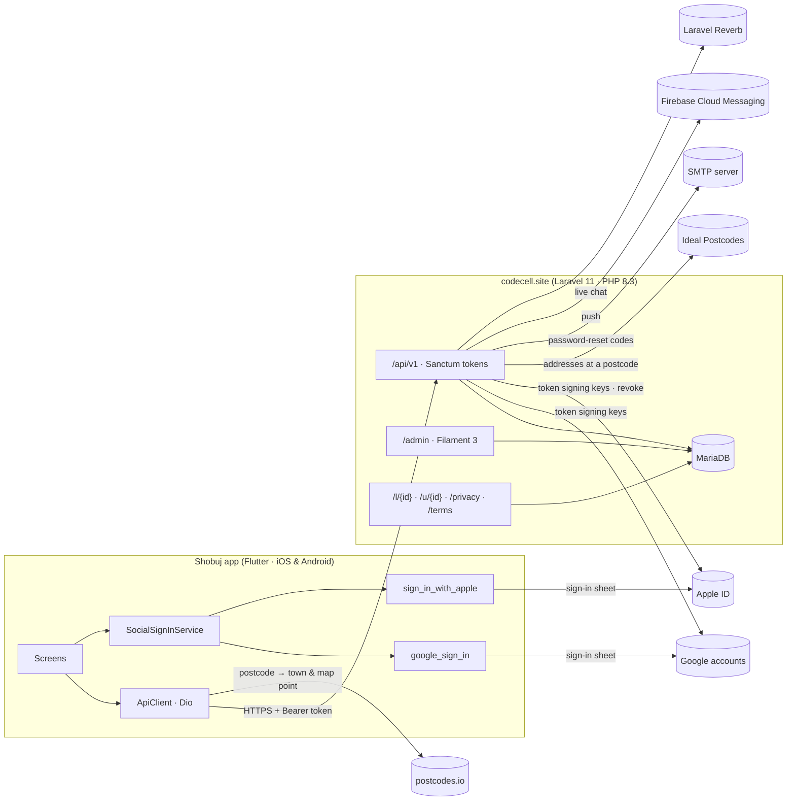
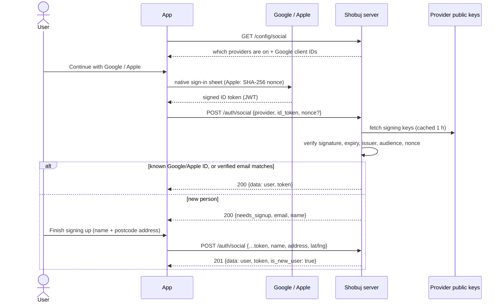
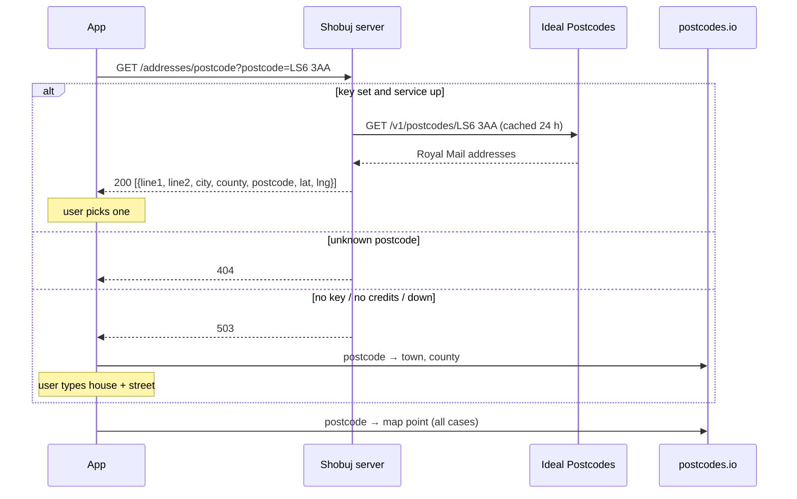

# Architecture

How Shobuj fits together, with a focus on the parts added in October 2026: social sign-in, postcode lookup, admin-managed settings and share pages. Endpoint details are in [`backend/docs/API-REFERENCE.md`](../backend/docs/API-REFERENCE.md).

## System overview

| Part | Where | Notes |
|---|---|---|
| Mobile app | `mobile/` | Flutter, Riverpod for state, Dio for HTTP. Every API call goes through `lib/services/api_client.dart`. |
| API | `backend/` → `/api/v1` | Laravel 11. Sanctum bearer tokens. Controllers in `app/Http/Controllers/Api/V1`, responses shaped by `Http/Resources`, validation in `Http/Requests`. |
| Admin panel | `backend/` → `/admin` | Filament 3. Any user with `is_admin`. Settings page: `app/Filament/Pages/ManageSettings.php`. |
| Public pages | `backend/routes/web.php` | Share pages (`SharePageController`), privacy and terms. |
| Database | MariaDB on the server | MySQL 8 locally for tests (spatial columns, so SQLite won't work). |
| Hosting | CloudPanel server (address and app root in `.deploy.env`, not in git) | Varnish in front; deploy with `./deploy.sh`. |

## Admin-managed settings

Config that the owner changes lives in the `settings` table, a key/value store whose values are **encrypted at rest** (`Setting::get/set`, `encrypted` cast). A saved value beats `.env`.

| Settings section | Keys | Read by | Public? |
|---|---|---|---|
| Social Sign-in: Google | `google_enabled`, `google_ios_client_id`, `google_server_client_id`, `google_client_ids` | `App\Support\SocialSettings` → `SocialTokenVerifier`, `SocialConfigController` | Client IDs yes (via `/config/social`) |
| Social Sign-in: Apple | `apple_enabled`, `apple_client_id`, `apple_team_id`, `apple_key_id`, `apple_private_key` | `SocialSettings` → `SocialTokenVerifier`, `AppleTokenRevoker` | Only `enabled`; the key **never** leaves the server |
| Address Lookup | `ideal_postcodes_api_key` | `PostcodeAddressService` | No |
| Email (SMTP) | `mail_host`, `mail_port`, `mail_encryption`, `mail_username`, `mail_password`, `mail_from_address`, `mail_from_name` | `App\Support\MailSettings` (applied when the mailer is first resolved, in `AppServiceProvider`) | No |
| App Download Links | `app_store_url`, `android_download_url` | `SharePageController` | Shown on share pages |
| Support Contact | `support_email` | Privacy and terms pages | Yes |
| Push (Firebase) | Uploaded file `storage/app/private/firebase-service-account.json` | Kreait Firebase | No |

**Rules for secrets:**
- They're never sent back to the browser; the form shows an empty field and *leave blank to keep*.
- The Apple `.p8` key is validated with `openssl_pkey_get_private` before it's saved.
- Social providers default to **off**: `google_enabled` and `apple_enabled` must be `'1'`.

## Sign in with Google / Apple

### Sequence

### Server

| Piece | File | Job |
|---|---|---|
| Endpoint | `AuthController::social` | Find by `google_id`/`apple_id` → else link a **verified** email → else `needs_signup`, or create the account when the address is sent. Suspended accounts → 403. |
| Validation | `Http/Requests/Auth/SocialLoginRequest` | `provider`, `id_token`, optional `nonce`. With `address_postcode`, the same address, location and interest rules as normal sign-up. |
| Token check | `Services/SocialTokenVerifier` | `firebase/php-jwt`. Fetches the provider's keys (Google `oauth2/v3/certs`, Apple `auth/keys`, cached 1 h) and checks the signature (RS256), `exp`, `iss`, `aud` and the Apple `nonce`. Unreachable provider → 503; bad token → 401. |
| Public config | `SocialConfigController` → `GET /config/social` | `{google: {enabled, ios_client_id, server_client_id}, apple: {enabled}}` |
| Apple revoke | `Services/AppleTokenRevoker` | On deletion, exchanges the app's authorization code at `appleid.apple.com/auth/token` (client secret: ES256 JWT signed with the `.p8` key, valid 5 min), then calls `/auth/revoke`. |
| Deletion | `AuthController::destroy` | `password`, **or** `provider` + `id_token` whose `sub` matches the linked ID. Works even when that provider is switched off. Optional `authorization_code` triggers the Apple revoke. |

**Accepted token audiences**
- **Google:** the iOS client ID, the Web client ID, and any extra client IDs.
- **Apple:** the app's bundle ID (`com.greenshelter.shobuj`, or the Services ID set in Settings).

### App

| Piece | File | Job |
|---|---|---|
| Sign-in sheets | `lib/services/social_sign_in_service.dart` | `availableProviders(config)` decides which buttons show; `signIn(provider, config)` returns a `SocialCredential`, or null if cancelled. Apple uses a random nonce (SHA-256 sent to Apple, raw value to the server). Google signs out of the SDK straight after, so nothing is kept on the device. |
| Settings fetch | `socialConfigProvider`, `availableSocialProvidersProvider` (`lib/providers/core_providers.dart`) | Fail closed: no buttons if `/config/social` can't be reached. |
| Buttons | `lib/screens/auth/widgets/social_sign_in_buttons.dart` | On Log In and Create Account. Apple's official `SignInWithAppleButton`. |
| New-user step | `lib/screens/auth/social_signup_screen.dart` | Name, `UkAddressFields`, terms → `AuthController.completeSocialSignup` → onboarding. |
| Deletion | `lib/screens/profile/privacy_safety_screen.dart` | No password? Then *Confirm with Google/Apple*. |
| iOS URL-scheme check | `ios/Runner/AppDelegate.swift`, channel `shobuj/app_info` | Returns the `CFBundleURLSchemes` from `Info.plist`; the Google button only shows on iPhone if the reversed iOS client ID is there. |
| Apple entitlement | `ios/Runner/RunnerDebug.entitlements` (Debug only) | Moves to Release after the App ID capability and profile are updated. |

**Platform rules**
- Apple: iPhone only.
- Google on Android: needs the Web client ID in Settings, plus an Android OAuth client (package `com.greensheal.shobuj` + signing SHA-1) in the same Google project.
- Google on iPhone: needs the iOS client ID in Settings, plus its reversed form as a URL scheme in `Info.plist`.

## Address from postcode

| Piece | File |
|---|---|
| Endpoint | `AddressController::postcode` (`GET /addresses/postcode`, 20/min per IP) |
| Service | `Services/PostcodeAddressService`. Normalises the postcode, caches 24 h, maps `line_1..3`, `post_town` (title-cased), `county`, `latitude`, `longitude`. |
| App widget | `lib/widgets/uk_address_fields.dart`, used by sign-up, Finish signing up, and Your address. |

The account's map location always comes from postcodes.io (`resolveUkAddress`). The stored location is offset 500–1000 m before anyone else sees it (`HasFuzzyLocation`).

## Share pages

`GET /l/{id}` (listing) and `GET /u/{id}` (profile) render `resources/views/share/page.blade.php`: a preview, Open Graph tags for link previews, and the download buttons from Settings. They show only public fields:
- **Listing:** title, price or type, category, seller name, first photo.
- **Profile:** name, username, avatar.

A closed listing, a missing record or a suspended account shows a fallback. The app builds the links from `AppConfig.webBaseUrl` (the API URL minus `/api/v1`), so they follow the domain change automatically.

## Data model changes (October 2026)

| Table | Column | Migration | Meaning |
|---|---|---|---|
| `users` | `google_id` (unique, nullable) | `2026_10_12_000002` | Google account `sub` |
| `users` | `apple_id` (unique, nullable) | `2026_10_12_000002` | Apple account `sub` |
| `users` | `has_password` (bool, default true) | `2026_10_12_000002` | False for accounts created with Google/Apple until a password is set by reset |
| `listing_categories` / `listings.listing_type` | renamed values | `2026_10_12_000001` | "Seed", "Live plants" |
| `settings` | new keys | (none, key/value) | See *Admin-managed settings* |

The `GET /auth/me` user payload adds `has_password` and `signed_in_with` (e.g. `["google"]`).

## Endpoints added or changed

| Method & path | Auth | Purpose |
|---|---|---|
| `GET /config/social` | none | Which sign-in providers are on, plus Google client IDs |
| `POST /auth/social` | none, 20/min | Sign in, sign up or link with a Google/Apple ID token |
| `DELETE /auth/me` | token | Now also accepts `provider` + `id_token` (+ `nonce`, `authorization_code`) instead of `password` |
| `GET /addresses/postcode` | none, 20/min | Every address at a UK postcode |
| `GET /l/{id}`, `GET /u/{id}` | none (web) | Share landing pages |
| `POST /auth/reset-password` | none | Now also sets `has_password = true` |

## Security

- **Social tokens:**
  - Verified on the server against the provider's published keys; signature, expiry, issuer and audience are all checked.
  - The app's word is never trusted.
  - Apple tokens are tied to a one-time nonce.
- **Email linking:** only happens when the provider says the email is verified.
- **Sessions:** the server issues its own Sanctum token. Google/Apple sessions aren't kept on the device.
- **Secrets:** encrypted in the database, write-only in the admin panel, never in API responses. The Apple key only signs short-lived (5 min) client secrets.
- **Rate limits:** public lookup and sign-in endpoints are rate-limited per IP.
- **Account deletion:** re-authentication is always required (password, or a fresh provider token for the same linked ID), and the Apple link is revoked when the key is configured.

## Deployment

1. Run the tests: `php artisan test` in `backend/`, `flutter test` in `mobile/`.
2. Take a backup on the server: database dump and code tarball into `~/backups/`.
3. `./deploy.sh` from the repo root. It:
   - uploads the code;
   - installs dependencies from `composer.lock`;
   - **lists leftover files** that exist on the server but not in the deploy;
   - shows pending migrations and asks before running them;
   - rebuilds caches;
   - purges Varnish;
   - smoke-tests the site.
4. If the pending list includes a migration that must not run yet (currently `2026_10_09_000001_remove_agri_ai_and_home_timeline`), answer **no**. Then run the wanted one alone with `php8.3 artisan migrate --force --path=database/migrations/<file>.php` and rebuild the caches.
5. Deploy the server **before** shipping an app build that calls new endpoints. Older app builds keep working against a newer server.
